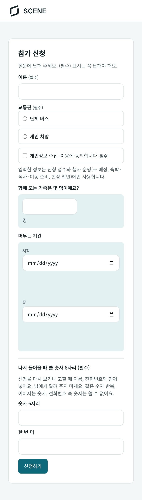
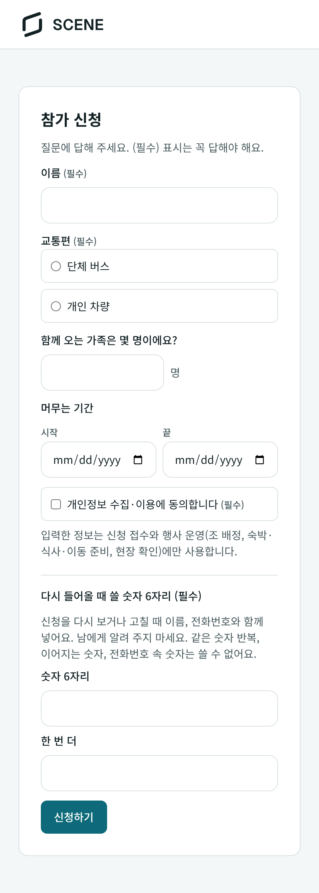

# 휴대폰 참가 신청 화면 정리 (#527)

2026-11-27. 참가 신청(`/apply/:eventId/:formId`) 414px 폭에서 시트 신청-10, 신청-기타 항목을 고쳤다.

- 기준: Figma `RreFdEVMiwgHrV7teaCEOm`에 참가자 신청서 화면 프레임이 없어(운영자 화면만 있음) 기존 요소·문구를 그대로 두고 배치만 고쳤다.
- 검증 종류: 개발 서버 화면에 API 응답을 고정해(`shots.cjs`, 교통 → 동의 → 직접 만든 숫자·기간 질문 순서) 414px 캡처. 실제 서버 검증과 실제 휴대폰 확인은 하지 않았다.

## 원인

숫자 질문 줄과 기간 질문 칸이 쓰던 `participant-gate__range` 클래스를 도착~출발 요약 상자(`RangeSummary`)도 쓰고 있었다. 뒤에 있는 요약 상자 규칙(세로 배치, 안쪽 여백, 연한 배경)이 덮어써서 단위가 아래 줄로 떨어지고, 기간 칸은 세로 배치에서 `flex-basis: 140px`가 높이로 잡혀 칸 아래가 비었다.

## 전→후

| 항목 | 전 | 후 |
|---|---|---|
| 숫자 질문 단위 | "명"이 입력칸 아래 줄, 연한 배경 상자 안 | 입력칸 바로 오른쪽, 상자 없음 |
| 기간 질문 | 시작·끝이 위아래로, 칸마다 아래 빈 공간, 연한 배경 상자가 화면 절반 | 시작·끝 한 줄에 나란히(좁으면 줄바꿈), 상자 없음 |
| 개인정보 동의 | 위치(position)대로 교통 질문 바로 뒤 | 보이는 질문 중 맨 마지막, 숫자 6자리 영역 바로 앞 |

동의 순서는 `visibleFields`에서 정하므로 참가 신청, 운영자 미리보기, 내 신청 화면이 같은 순서를 따른다. 신청서 설정의 질문 목록은 저장된 위치 순서 그대로다.

| 전 | 후 |
|---|---|
|  |  |
