# I2 MANAGER 기본 권한 확인 (#429, DEC-079 Follow-up 2026-11-20)

2026-11-20, 클라우드 세션. 운영 서버 확인은 하지 않았다(사용자 몫).

## 구분

| 종류 | 무엇 | 결과 |
| --- | --- | --- |
| 문서 작성 | PRODUCT_DECISIONS(DEC-079 Follow-up과 DEC-029·054·072·075·080·회고 메모), api.md, source-guide, api-architecture, 일정·공지 계약 | 완료 |
| 서버 검증 | `./gradlew check`(Docker PostgreSQL 17 Testcontainers, JDK 25) | 통과. 테스트 471개, 실패 0 |
| 화면 검증 | `pnpm lint`·`typecheck`·`test`(543개)·`build` | 통과 |
| 실제 클릭 | 로컬 서버(`bootRun` local 프로필, PostgreSQL 17) + Vite `VITE_API_MOCK=0`, Playwright. 스크립트 [i2-manager-defaults-click.cjs](i2-manager-defaults-click.cjs), 출력 [i2-manager-defaults-click.log](i2-manager-defaults-click.log) | 아래와 같음 |

## 실제 클릭 결과

새 행사를 만들고 Local manager(MANAGER)·Local staff(STAFF)를 넣었다. 개별 권한(override)은 하나도 걸지 않았다.

MANAGER(override 없음, `{"grants":[],"revokes":[]}`):

- 조 편성판에서 김하나를 골라 1조로 보냈다. 서버 편성판에 `김하나 → 1조`로 남았다. 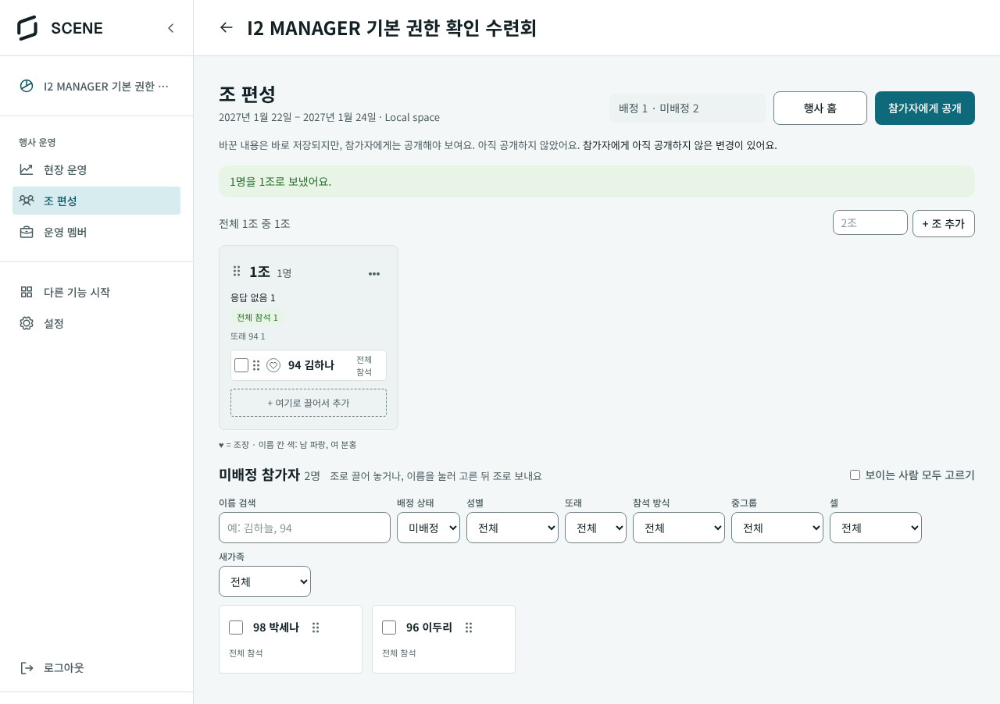
- 참가 현황 표에 연락처 열과 전체 전화번호가 보였다. 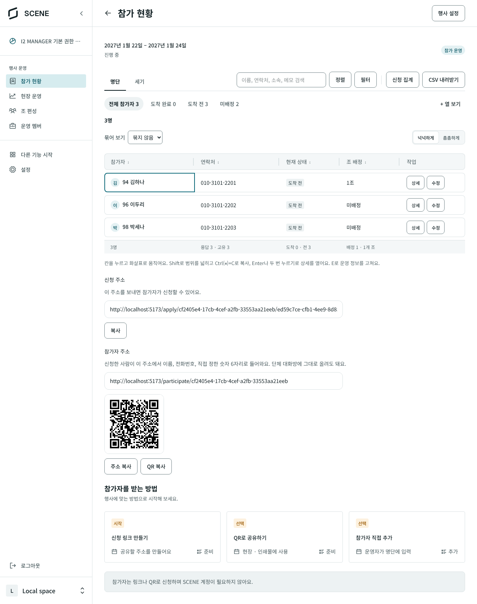
- "CSV 내려받기" → 확인 창 → 파일을 받았다(머리줄+3명, 전화 포함). 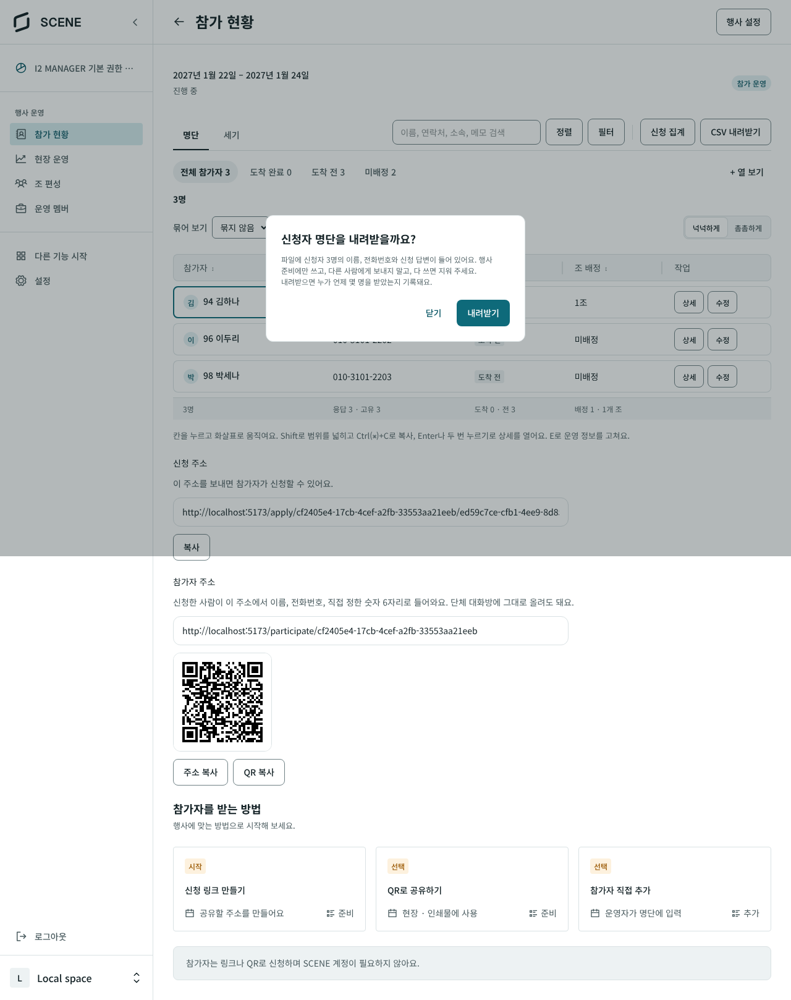
- 운영 멤버 화면에 권한·역할 변경·빼기 버튼이 없다. 서버도 권한 `PUT`·역할 `PATCH`를 `403 FORBIDDEN`으로 막는다. 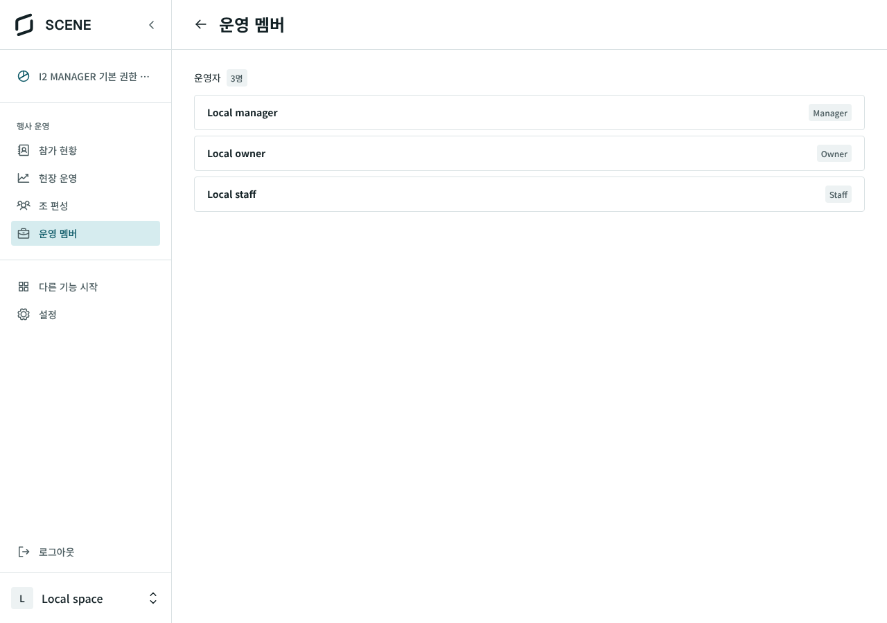
- 행사 종료 화면은 "행사 Owner만 종료할 수 있어요."이고 `POST …/end`는 `403 FORBIDDEN`이다. 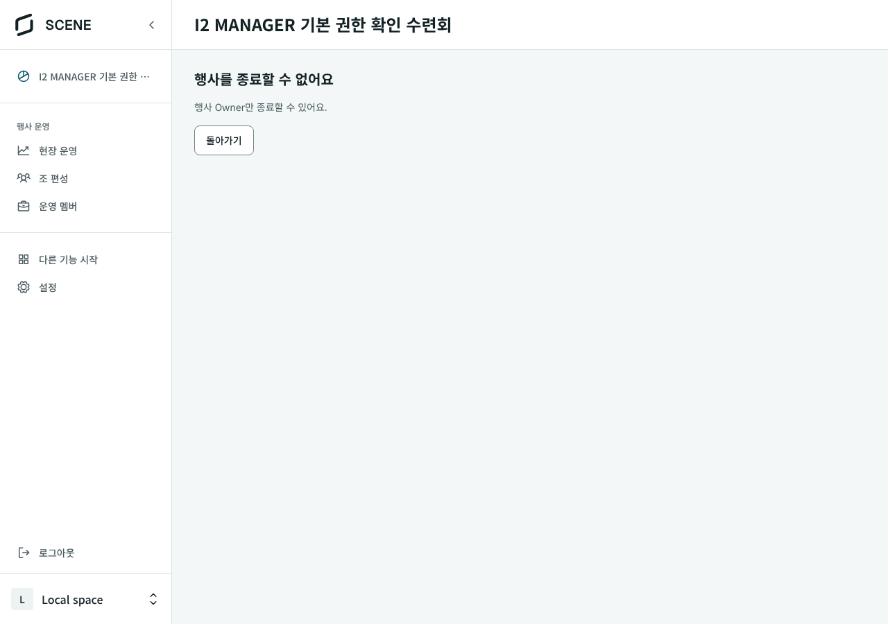

OWNER 화면:

- Local manager의 권한 창에서 11개 항목이 모두 "역할 기본"으로 켜져 있고, "Manager는 기본으로 행사 시작·종료와 운영 멤버 관리만 빼고 모두 할 수 있어요."가 보인다. 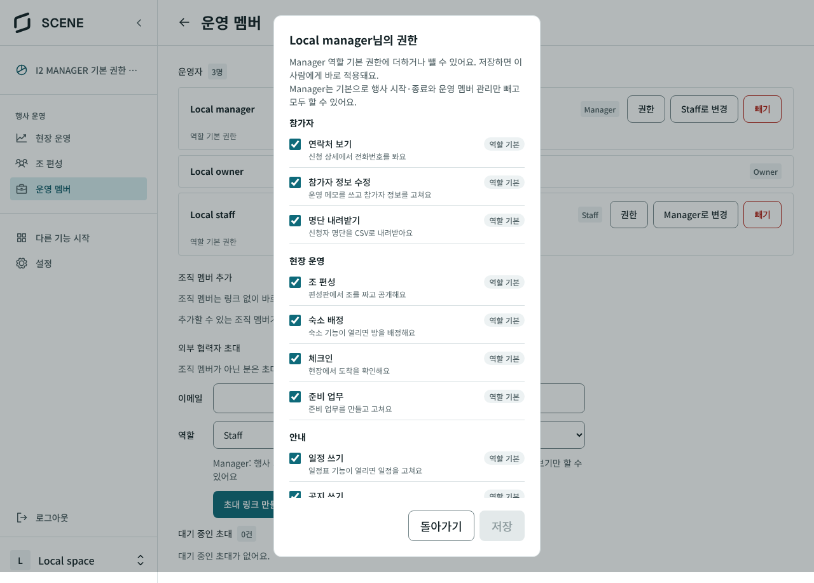
- Local staff의 권한 창은 체크인만 켜져 있고 조 편성은 꺼져 있다. 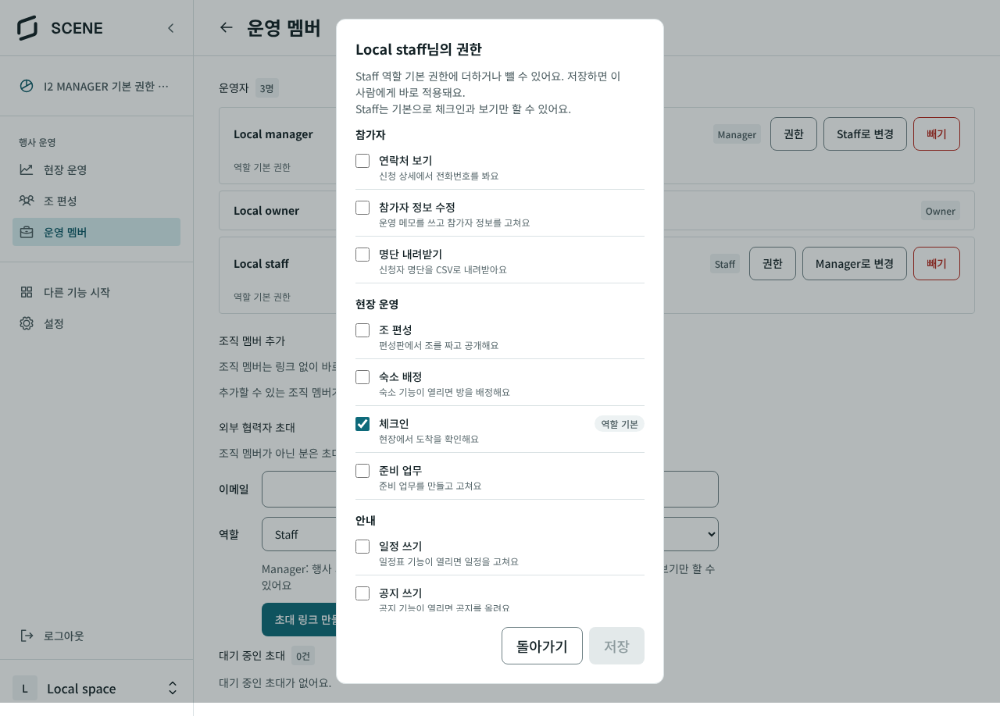
- 초대 역할 아래 한 줄: "Manager: 행사 시작·종료와 운영 멤버 관리만 빼고 모두 할 수 있어요 · Staff: 체크인과 보기만 할 수 있어요". 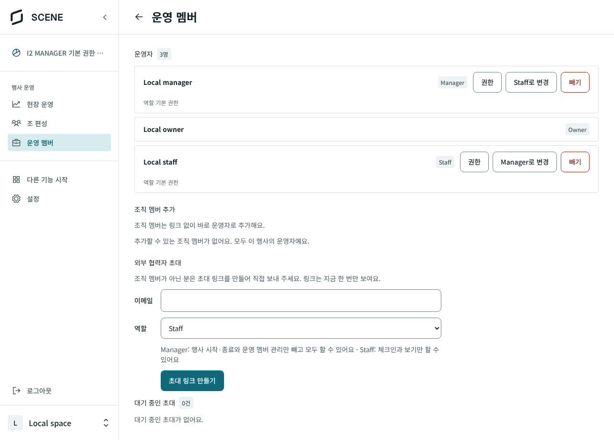

STAFF:

- 현장 운영에서 김하나를 체크인했다(서버 집계 1/3). 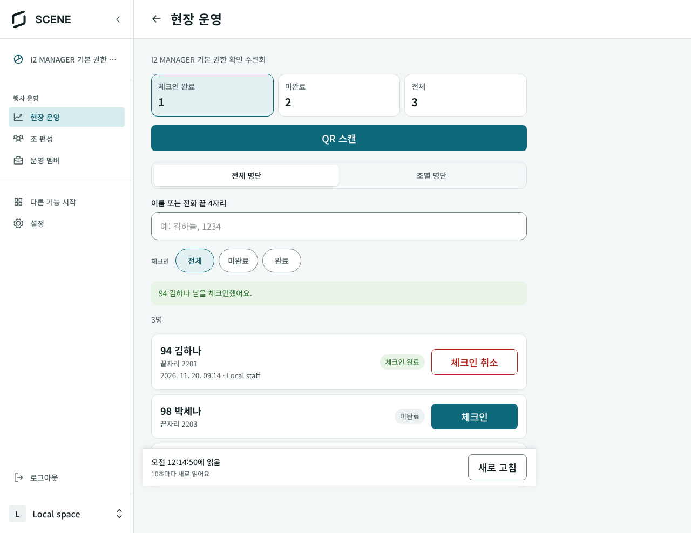
- 조 편성판은 "조 편성을 볼 권한이 없어요". 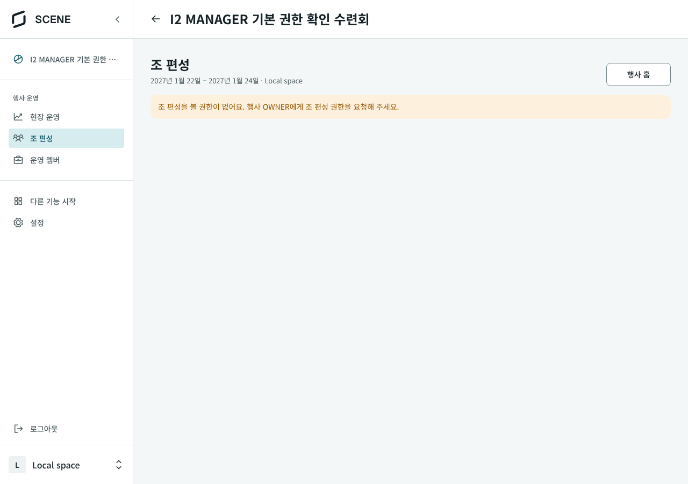
- 참가 현황 표에 연락처 열과 CSV 버튼이 없다. CSV 요청은 `403 FORBIDDEN`이다. 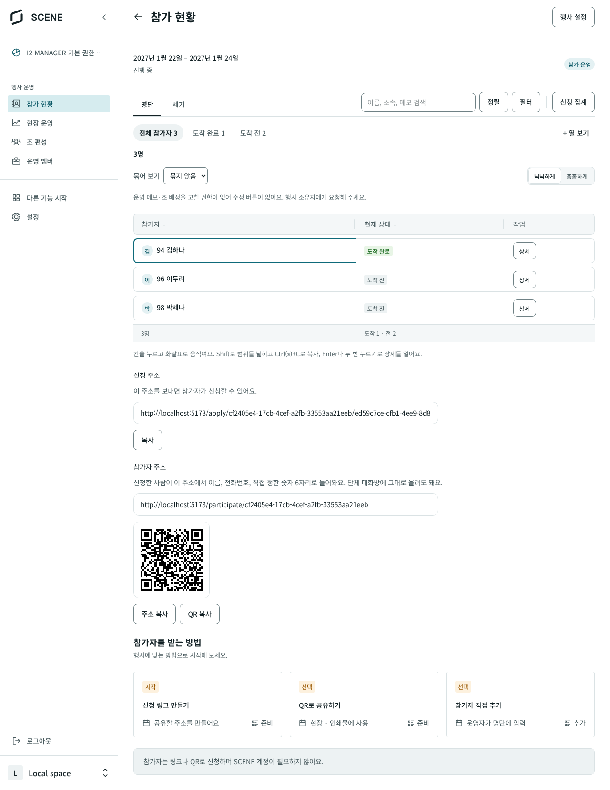

## 사용자가 운영 서버에서 확인할 것

1. 배포 뒤 기존 행사의 MANAGER 계정으로 조 편성판·참가 현황 연락처 열·CSV 내려받기가 권한 창을 거치지 않고 되는지.
2. 같은 MANAGER에게 행사 종료 버튼과 운영 멤버의 권한·역할 변경 버튼이 없는지.
3. STAFF 계정은 체크인만 되는지.
4. 특정 MANAGER에게서 빼고 싶은 권한(예: 명단 내려받기)이 있으면 OWNER가 권한 창에서 끄면 되는지.
